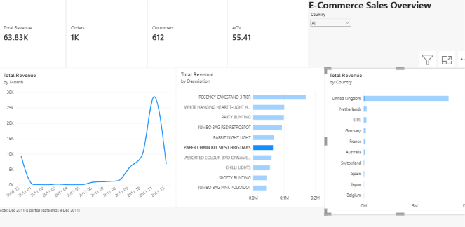
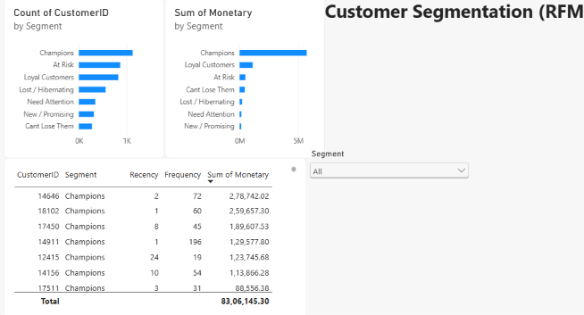
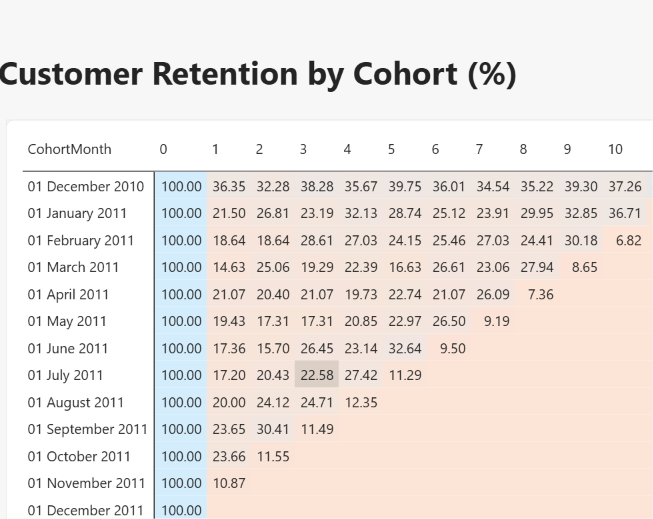
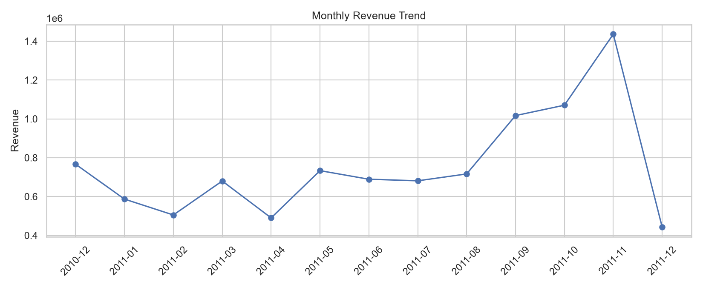
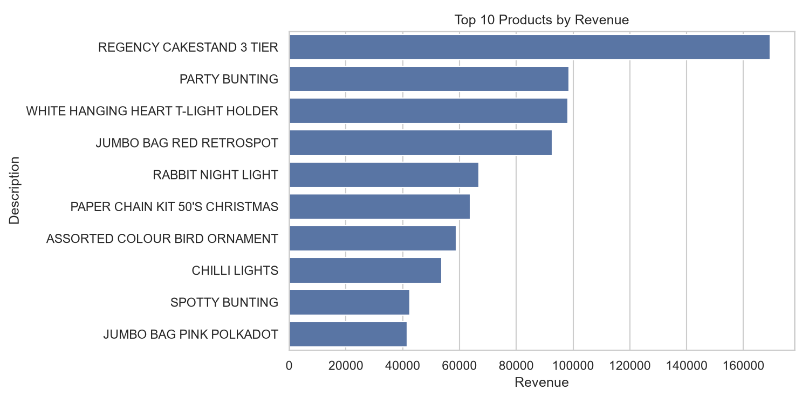
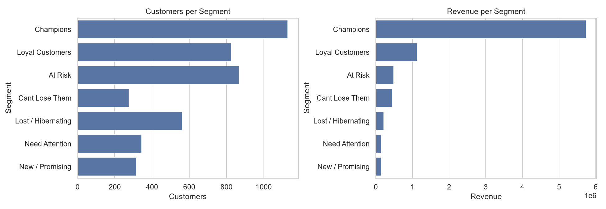
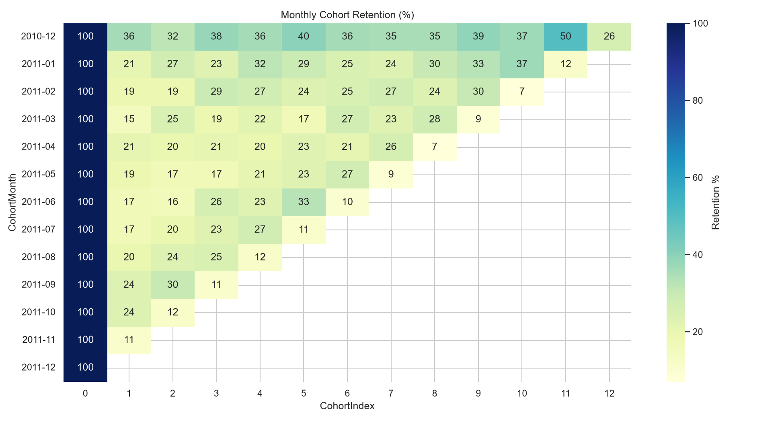

# E-Commerce Sales Performance Analysis

End-to-end analysis of ~540k online retail transactions (UK-based retailer, Dec 2010 – Dec 2011) using **Python, SQL and Power BI**: sales trends, product and country performance, RFM customer segmentation and cohort retention.

**Dataset:** [E-Commerce Data on Kaggle](https://www.kaggle.com/datasets/carrie1/ecommerce-data) (`data.csv`, 541,909 rows, 8 columns). The file is not included in this repo because of its size; download it and place it in the project folder.

## Tools
- **Python** (Pandas, NumPy, Matplotlib, Seaborn): cleaning, analysis, RFM, cohorts
- **SQL** (SQLite): KPI queries, window functions (LAG, RANK, NTILE), cohort retention
- **Power BI**: 3-page interactive dashboard

## Business questions
1. Which products, countries and months drive revenue?
2. Which customer segments matter most?
3. How well does the business retain customers after their first purchase?

## Data cleaning (`01_analysis.py`)
| Step | Rows |
|---|---|
| Raw rows | 541,909 |
| Duplicates removed | 5,268 |
| Cancelled / return rows set aside (used for returns analysis) | 9,251 |
| Rows with quantity <= 0 or price <= 0 removed | 2,512 |
| Non-product rows removed (postage, fees, manual entries) | 2,374 |
| Fully-cancelled sales netted out (same customer, product, quantity) | 3,083 (value 431,082) |
| **Clean sales rows** | **519,421** |

Rows with no CustomerID (25.3%) are kept for sales analysis but excluded from RFM and cohort analysis.

## Key findings
- **Revenue:** 9.82M total; 19.6K orders; 4,322 identified customers; average order value about 500.
- **Seasonality:** Oct–Dec brings 37.9% of revenue; November 2011 is the peak month (1.44M).
- **Products:** the top 20% of products generate 78.6% of revenue. Top product: REGENCY CAKESTAND 3 TIER.
- **Geography:** the United Kingdom accounts for 84.7% of revenue, so international markets are still small.
- **Returns:** return value equals 8.7% of gross revenue.
- **RFM segmentation:** Champions are 26.1% of customers but 69.0% of revenue. The top 20% of customers contribute 73.7% of known-customer revenue.
- **Retention:** 65.2% of customers bought more than once, but average Month-1 retention is only 20.4% (Month-3: 23.3%).

## Recommendations
- Protect **Champions** with loyalty rewards and early access, since they drive about 70% of revenue.
- Run win-back campaigns for **At Risk** and **Cant Lose Them** customers (1,143 customers).
- Send a follow-up offer 2–3 weeks after the first purchase to improve Month-1 retention.
- Build inventory ahead of **Q4** (stock up by September–October).
- Review quality and product descriptions of the most-returned items.

## Dashboard (Power BI)
| Sales Overview | RFM Segments | Retention |
|---|---|---|
|  |  |  |

The Power BI file is in `dashboard/ecommerce_dashboard.pbix`.

## Analysis charts





## How to run
```
pip install -r requirements.txt
python 01_analysis.py data.csv
```
This creates an `output/` folder with cleaned CSVs for Power BI, charts, an SQLite database (`ecommerce.db`) and `key_numbers_summary.txt`. Run the queries in `02_sql_queries.sql` against `ecommerce.db`.

## Limitations
- The dataset has no cost data, so profit and margin analysis is not possible; revenue concentration and returns analysis are used instead.
- It covers only about one year, so seasonality is an indication, not proof. December 2011 is partial (data ends 9 Dec 2011).
- About 25% of rows have no CustomerID, so customer-level results cover identified customers only.
- Cancellation netting matches on customer, product and quantity. Partial cancellations and cancellations without a CustomerID are not netted.

## Possible next steps
Customer lifetime value (CLV) prediction, K-Means clustering compared with RFM, market basket analysis, and a churn model.
